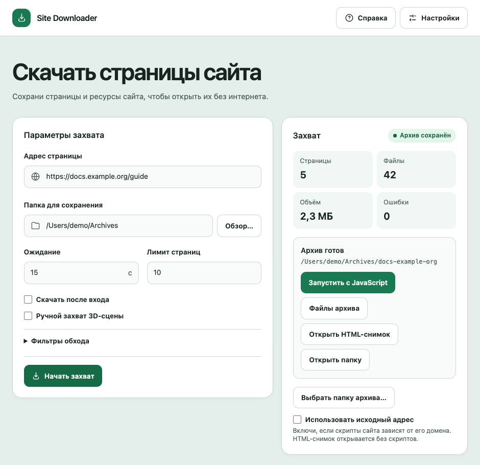

<div align="center">
  

  <h1>Site Downloader</h1>

  <p><strong>Скачивай страницы и ресурсы сайта, изучай их структуру и открывай архив без интернета.</strong></p>

  <p><a href="https://github.com/proksiks/site-downloader/releases/latest"><strong>↓ Скачать для компьютера</strong></a></p>
</div>

## Скачать и установить

**Если у тебя Mac с чипом M1, M2, M3, M4 или новее, скачай [версию для Mac с Apple Silicon (.dmg)][mac-apple].**

Прямые ссылки для версии [v0.1.0](https://github.com/proksiks/site-downloader/releases/tag/v0.1.0):

| Компьютер | Установщик | Что делать после скачивания |
| --- | --- | --- |
| **Mac с чипом Apple серии M**, macOS 14 и новее | [Скачать .dmg для Apple Silicon][mac-apple] | Открой образ и перетащи Site Downloader в «Программы». |
| **Mac с процессором Intel**, macOS 14 и новее | [Скачать .dmg для Intel][mac-intel] | Открой образ и перетащи Site Downloader в «Программы». |
| **Windows 11, 64-битная (x64)** | [Скачать установщик .exe][windows] | Запусти файл и следуй шагам установки. |
| **Ubuntu или Debian, 64-битные (x64)** | [Скачать пакет .deb][linux-deb] | Открой пакет в установщике приложений или выполни `sudo apt install ./имя-файла.deb`. |
| **Другие дистрибутивы Linux, 64-битные (x64)** | [Скачать .AppImage][linux-appimage] | Разреши запуск файла в его свойствах и открой его. Для Chromium могут потребоваться системные библиотеки. |

**Как узнать, какой у тебя Mac.** Открой  → «Об этом Mac». Если в строке «Чип» указано Apple M с номером, выбирай Apple Silicon. Если в строке «Процессор» указано Intel, выбирай Intel. [Справка Apple](https://support.apple.com/ru-ru/116943)

**Первый запуск.** Установщик уже включает Node.js. При первом захвате приложение само скачает Chromium, если его ещё нет. На macOS и Windows может появиться предупреждение о неподписанной сборке. Версии для iPhone и iPad пока нет.

[mac-apple]: https://github.com/proksiks/site-downloader/releases/download/v0.1.0/Site.Downloader_0.1.0_aarch64.dmg
[mac-intel]: https://github.com/proksiks/site-downloader/releases/download/v0.1.0/Site.Downloader_0.1.0_x64.dmg
[windows]: https://github.com/proksiks/site-downloader/releases/download/v0.1.0/Site.Downloader_0.1.0_x64-setup.exe
[linux-deb]: https://github.com/proksiks/site-downloader/releases/download/v0.1.0/Site.Downloader_0.1.0_amd64.deb
[linux-appimage]: https://github.com/proksiks/site-downloader/releases/download/v0.1.0/Site.Downloader_0.1.0_amd64.AppImage

## Что умеет

- **Обход сайта.** Находит подстраницы по ссылкам и сохраняет ресурсы, которые загрузил браузер, включая файлы с CDN и JavaScript-бандлы.
- **Захват после входа.** Войди на сайте в отдельном окне Chromium и продолжи захват в той же временной сессии.
- **Фильтры.** Ограничь обход каталогом вроде `/docs`, исключи отдельные пути или убери видео из архива.
- **Офлайн-просмотр.** Открывай копию отрисованных страниц с локальными ссылками, стилями и изображениями.
- **Оформление.** Меняй тему, палитру, фон, шрифт и масштаб интерфейса.

## Первый захват

1. Вставь URL страницы и выбери папку для архива.
2. При необходимости настрой лимит страниц, время ожидания или пути обхода. По умолчанию приложение открывает до 10 страниц и ждёт ресурсы ещё 15 секунд на каждой.
3. Нажми **Начать захват**. Для закрытых страниц сначала включи **Скачать после входа**, войди на сайте и подтверди продолжение в приложении.
4. Нажми **Смотреть офлайн** или **Открыть папку**.

Обход идёт по ссылкам в пределах одного протокола, домена и порта. Закрытые страницы могут содержать данные аккаунта в сохранённом HTML и ресурсах.



## Как устроен архив

```text
├── index.html
├── docs/
│   └── guide/index.html
├── assets/
│   ├── example.com/_next/static/chunks/app.js
│   └── cdn.example.net/images/logo.svg
├── offline/
│   ├── index.html
│   └── docs/guide/index.html
└── manifest.json
```

Страницы сохраняются по маршрутам, ресурсы — по доменам и исходным каталогам. Параметры URL и совпадения имён различаются короткими суффиксами. В `manifest.json` можно найти исходный URL, локальный путь, тип и размер файла, а также адрес входа в офлайн-копию.

В `assets/` остаются ответы браузера, включая загруженные бандлы. Офлайн-копия показывает снимок страниц со статическими ресурсами. Скрипты, отправка форм и сетевые запросы в ней отключены.

## Разработка

**Rust · Tauri · Nuxt · Tailwind CSS · Playwright**

Нужны Node.js 22+, Rust и [системные зависимости Tauri](https://v2.tauri.app/start/prerequisites/).

```sh
npm ci
npm run browser:install
npm run tauri dev
```

Для установщика со встроенным Node.js выполни `npm run release:build` на целевой ОС. Артефакты появятся в `src-tauri/target/release/bundle/`. Сборка и публикация всех настольных форматов запускаются в [GitHub Actions](.github/workflows/release.yml) по тегу вида `v0.1.0`, совпадающему с версией приложения.
